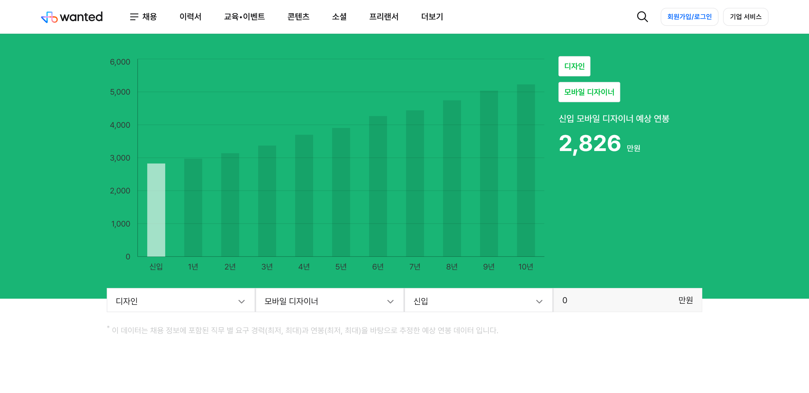
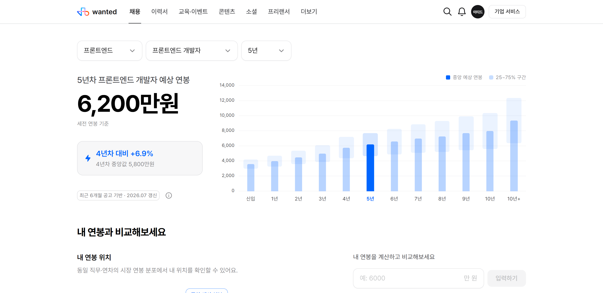
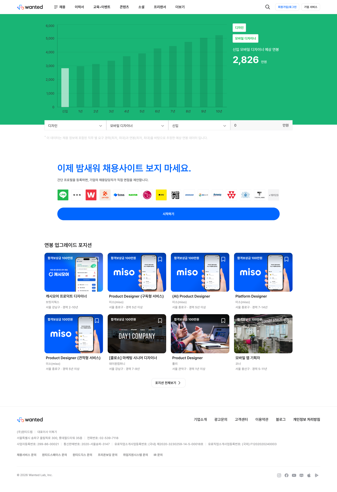
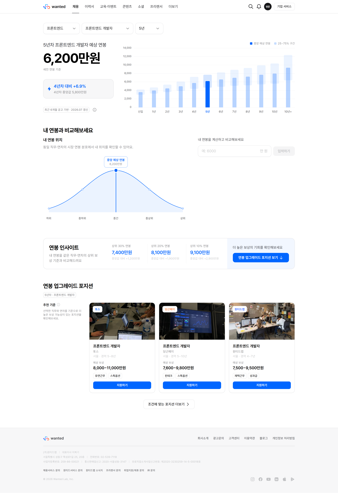

# 원티드 연봉 페이지 리디자인

원티드(wanted.co.kr)의 **직무별 연봉 페이지**를 처음부터 다시 설계한 리디자인 프로젝트입니다.
기존 페이지가 "숫자 하나를 보여주고 끝나는 화면"에 머물러 있다는 문제의식에서 출발해,
**탐색 → 비교 → 다음 행동**까지 이어지는 하나의 흐름으로 다시 구성했습니다.

| | 링크 |
| --- | --- |
| 🔗 **리디자인 (Live)** | https://wanted-salary-redesign.pages.dev |
| 🔗 **레거시 원본** | https://www.wanted.co.kr/salary/595 |

> ⚠️ **고지** — 이 프로젝트는 **개인 디자인 학습·포트폴리오 목적의 비공식 리디자인**이며, 원티드랩(Wanted Lab, Inc.)과 아무런 제휴 관계가 없습니다.
> 화면에 표시되는 연봉·분포·채용 포지션 수치는 **전부 UI 검증용 더미 데이터**이고 실제 시장 데이터가 아닙니다.

---

## 스냅샷

### Before — 레거시



### After — 리디자인



### 전체 페이지 비교

| Before | After |
| --- | --- |
|  |  |

---

## 문제 정의

레거시 페이지를 뜯어보면서 정리한 네 가지 문제입니다.

| # | 문제 | 설명 |
| --- | --- | --- |
| 1 | **정보가 한 점에 머문다** | "신입 모바일 디자이너 2,826만원" 처럼 중앙값 하나만 제시한다. 같은 직무·연차 안에서도 연봉은 넓게 퍼져 있는데, 그 분포가 화면에 없다. |
| 2 | **숫자의 근거가 보이지 않는다** | 데이터 출처·집계 기간이 본문 하단에 각주 한 줄로만 존재해, 신뢰 판단을 할 근거가 약하다. |
| 3 | **"내" 이야기가 없다** | 연봉 입력란은 있지만 입력 결과가 "내가 시장에서 어디쯤인지"로 환원되지 않는다. |
| 4 | **탐색과 행동이 끊긴다** | 상단 연봉 조회와 하단 채용 공고가 서로 연결되지 않는다. 조회 조건(직무·연차)이 추천에 반영되지 않는다. |

## 리디자인 의도

위 문제를 **하나의 서사(narrative)** 로 다시 엮었습니다. 페이지를 위에서 아래로 읽으면
`시장은 이렇다 → 근거는 이렇다 → 너는 여기 있다 → 그래서 다음은 이것이다` 가 되도록 섹션을 배치했습니다.

### 1. Hero — 점(point)이 아니라 분포(distribution)

- 레거시의 **단일 막대 그래프**를 **중앙값 막대 + 25~75% 사분위 구간**이 겹친 차트로 교체했습니다.
  진한 막대가 중앙값, 뒤에 옅게 깔린 띠가 "흔히 받는 구간"입니다.
- 연차 축을 **신입 / 1년 … 10년 / 10년+ 총 12단계**로 확장해 커리어 전체 곡선이 한눈에 보이게 했습니다.
- 막대를 클릭·포커스하면 그 연차로 전환되고, **포인터를 따라다니는 툴팁**이 예상 연봉·주요 분포·직전 연차 대비 증감을 동시에 보여줍니다.
- 선택 연차의 금액을 `display` 타이포로 크게 두고, 그 아래 **직전 연차 대비 상승률**을 배치해
  "지금 얼마"와 "어떻게 올라가는가"를 한 덩어리로 읽히게 했습니다.

### 2. 데이터 신뢰 레이어 — 각주에서 UI로

- `최근 6개월 공고 기반 · 2026.07 갱신` 메타 정보를 각주에서 꺼내
  금액 바로 아래 **칩(chip) + 정보 아이콘**으로 올렸습니다. 숫자와 근거가 같은 시선 안에 들어옵니다.

### 3. 내 연봉 비교 — 입력을 위치로 환원

- 내 연봉을 입력하면 **정규분포 곡선 위의 마커**로 변환되어 "상위 몇 %"가 즉시 나옵니다.
- 축을 `하위 · 중하위 · 중간 · 중상위 · 상위` 로 **등간격** 배치해, 백분위를 모르는 사용자도 위치를 읽을 수 있게 했습니다.
- 마커는 **드래그 가능**하며 입력 필드와 **양방향 동기화**됩니다. 숫자를 치지 않아도 "이 정도면 어디쯤?"을 탐색할 수 있습니다.
- `연봉 상세 보기` 아코디언에서 입력 연봉 → 월 세전 급여 → **예상 월 실수령액**까지 펼쳐 봅니다.

### 4. 인사이트 — 목표를 숫자로

- 상위 30% / 20% / 10% 연봉을 중앙값 대비 차액과 함께 제시해
  "더 받고 싶다"는 막연한 생각을 **구체적인 금액 목표**로 바꿉니다.

### 5. 연봉 업그레이드 포지션 — 탐색과 행동의 연결

- 상단에서 고른 **직무·연차 조건이 그대로 추천에 반영**됩니다. 적용된 조건은 배지로 다시 노출됩니다.
- 각 카드는 예상 보상 구간과 **현재 연봉 대비 상승폭**을 함께 보여줘, 앞 섹션의 인사이트를 실제 공고로 잇습니다.

### 그 외 설계 원칙

- **단일 진실 공급원(Single source of truth)** — 직무·연차·내 연봉 상태를 페이지 최상단에서 한 번만 관리하고 모든 섹션이 이를 구독합니다.
- **디자인 시스템 준수** — 임의의 색상·간격 값을 쓰지 않고 Montage 토큰만 사용했습니다. 간격은 Montage 스케일 위에서 역할(섹션 / 제목→본문 / 요소) 기준으로 정의한 규약(`src/styles/spacing.ts`)을 두고, 각 섹션에 순차 적용 중입니다.
- **접근성** — 시맨틱 헤딩 구조, 키보드 포커스 링, `aria-label`, `prefers-reduced-motion` 대응, 증감을 색상만으로 전달하지 않기.
- **글래스모피즘 같은 장식적 효과 배제** — 모든 요소를 역할에 맞는 디자인 시스템 컴포넌트로 환원했습니다.

---

## 기술 스택

| 분류 | 사용 기술 |
| --- | --- |
| **언어** | TypeScript |
| **프레임워크** | Next.js 16 (App Router) · React 19 · Turbopack |
| **디자인 시스템** | [Montage (`@wanteddev/wds`)](https://github.com/wanteddev/montage-web) — 원티드 공식 디자인 시스템 |
| **스타일링** | Emotion (CSS-in-JS, App Router SSR 구성) |
| **타이포그래피** | Pretendard (dynamic subset, CDN) |
| **차트** | 차트 라이브러리 없이 CSS/HTML·SVG로 직접 구현 |
| **배포** | Cloudflare Pages (Next.js static export) |

### 사용 툴

| 툴 | 용도 |
| --- | --- |
| **Claude Code** | 전체 구현 및 리디자인 반복(iteration) |
| **Montage MCP Server** | 디자인 시스템의 컴포넌트·토큰·아이콘 스펙 조회 |
| **Figma** | 와이어프레임 및 레이아웃 설계 |
| **Wrangler** | Cloudflare 배포 |

> 차트는 의도적으로 외부 라이브러리를 쓰지 않았습니다. 사분위 밴드가 중앙값 막대에 종속되는 위계,
> 포인터 추종 툴팁, 드래그 가능한 분포 마커 같은 요구를 토큰 기반으로 정확히 통제하기 위해서입니다.

---

## 로컬 실행

> ⚠️ 이 프로젝트는 Montage(`@wanteddev/wds`)를 **로컬 경로(`file:`)로 링크**해 사용합니다.
> Montage는 GitHub Packages(`npm.pkg.github.com`)로 배포되는 패키지라, 먼저 저장소를 내려받아 형제 디렉터리에 두어야 합니다.

```bash
# 1. Montage 를 이 저장소와 같은 레벨에 배치
#    projects/
#    ├── montage-web-main/      <- github.com/wanteddev/montage-web
#    └── wanted-salary-redesign/
git clone https://github.com/wanteddev/montage-web montage-web-main

# 2. 의존성 설치 & 개발 서버
pnpm install
pnpm dev          # http://localhost:3000
```

### 빌드 & 배포

```bash
pnpm build                                  # out/ 에 정적 사이트 생성
npx wrangler pages deploy out --project-name wanted-salary-redesign
```

---

## 프로젝트 구조

```
src/
├── app/
│   ├── layout.tsx                  # Emotion SSR · Pretendard · 메타데이터
│   ├── providers.tsx               # ThemeProvider + AppRouterCacheProvider
│   └── page.tsx
├── components/
│   ├── layout/                     # GNB · 푸터 · 로고
│   └── salary/
│       ├── SalaryPage.tsx          # 페이지 상태의 단일 진실 공급원
│       ├── HeroSection.tsx         # 필터 + 요약 + 막대 차트
│       ├── SalaryBarChart.tsx      # 중앙값 막대 + 사분위 밴드
│       ├── SalaryMetaInfo.tsx      # 데이터 신뢰 메타
│       ├── SalaryCompareSection.tsx
│       ├── SalaryDistributionChart.tsx  # 분포 곡선 + 드래그 마커
│       ├── SalaryDetailAccordion.tsx
│       ├── SalaryInsightSection.tsx
│       └── UpgradePositionsSection.tsx
├── data/
│   └── salary.ts                   # 더미 데이터 + 분포·백분위 계산
└── styles/
    └── spacing.ts                  # 역할 기반 간격 규약
```

---

## 라이선스 및 고지

- 이 저장소의 코드는 개인 학습·포트폴리오 목적으로 공개합니다.
- **원티드(Wanted Lab, Inc.)의 공식 프로젝트가 아니며 어떠한 제휴 관계도 없습니다.**
- 원티드 로고 및 브랜드 자산의 권리는 원티드랩에 있습니다.
- Montage 디자인 시스템은 [MIT License](https://github.com/wanteddev/montage-web/blob/main/LICENSE.md)를 따릅니다.
- 화면의 모든 연봉·채용 데이터는 **더미 데이터**입니다. 실제 의사결정에 사용할 수 없습니다.
